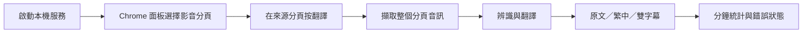
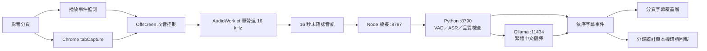

# MosaSub Live 0.3.6 架構與功能

## 產品範圍

MosaSub Live 是 Windows 本機即時字幕原型。使用者從 Chrome 擴充套件選擇一個 HTTP/HTTPS 影音分頁，系統擷取該分頁的混合音訊，辨識原文並翻譯為繁體中文。字幕可顯示僅繁中、僅原文或雙語。

目前已在 Twitch 與單段測試音訊上開發及驗證核心路徑；其他影音網站仍需逐站實播驗收。系統不繞過受保護影音，也無法從同一分頁的多個播放器中隔離單一播放器。

## 使用流程

Chrome 的 `tabCapture` 必須由使用者手勢在被擷取分頁啟動。因此從面板選擇其他分頁時，擴充套件先前往該分頁，再由使用者點一次圖示啟動。這是瀏覽器權限限制。

## 資料流

## 主要元件

|位置|責任|
|---|---|
|`extension/popup.js`|列出分頁、啟停、服務狀態、術語與診斷|
|`extension/background.js`|啟停、腳本注入、設定與字幕事件轉送|
|`extension/playback.js`|監測播放器替換、跳播、等待與停滯|
|`extension/offscreen.js`|持有 tabCapture 音訊、連線與活動狀態|
|`extension/overlay.js`|字幕模式、停留時間、外觀與快捷操作|
|`extension/session-stats.js`|每分鐘定稿、延遲、丟棄、恢復與顯存摘要|
|`web/engine.js`、`worklet.js`|收音、重採樣、音訊包與重設確認|
|`web/live-client.js`|最多兩包處理、排序、重送與負載降級|
|`server.mjs`|輸入限制、模型橋接、健康與資源端點|
|`windows/models.py`|辨識、翻譯、16 筆快取、排程與品質標記|
|`windows/live_audio.py`|Silero VAD、斷句、前置音訊與共同前綴穩定化|
|`windows/quality_checks.py`|數字、否定、用語與低可信結果檢查|
|`windows/launch.py`|啟動服務並在異常退出後恢復|

`web` 與 `extension` 內的收音核心檔案是同步副本；測試會檢查內容一致。

## 收音與斷句

AudioWorklet 將聲道混合並重採樣為 16 kHz，每 320 ms 傳一包。後端保留約 224 ms 前置音訊，約 416 ms 靜音可送暫定辨識；一般約 896 ms 靜音才定稿，連續講話約 6 秒硬分段。保守定稿可降低句中腰斬，但會增加停句後等待。

字幕停留與斷句分開設定。固定模式提供 2／3／5／8 秒與手動；自動模式依字數在 2.5–8 秒間調整。使用者可只顯示定稿，以減少暫定文字跳動。

## 推論與資源界線

預設 Faster-Whisper small；CUDA 使用 `int8_float16`，CPU 使用 `int8`。自動多語模式傳入 `language=None`；英文、日文與韓文鎖定模式分別傳入 `en`、`ja`、`ko`。語言鎖定不是字元白名單，選錯語言時其他語音會被硬辨識為指定語言。系統不把上一整句當 Whisper 提示。翻譯由本機 Ollama Qwen 模型執行，實際模型以環境設定為準。

ASR 與翻譯分開排程，最多兩包尚未完成。前一包翻譯時可辨識下一包，輸出仍按批次順序呈現。翻譯上下文最多兩句，翻譯快取最多 16 筆；未確認音訊最多 16 秒，超量時保留最近 8 秒並記錄丟棄量。

面板每 15 秒抽樣整張顯卡顯存，數值包含遊戲與其他程式，不能當成 MosaSub 單獨用量。最近 60 個活動分鐘只保留在 offscreen 記憶體；使用者主動回報的字幕最多保存 30 筆於 Chrome 本機，不保存音訊。

## 恢復與品質防護

- 播放跳躍、等待與停滯會重設舊緩衝及時間基準。
- 傳輸失敗重送相同批次；後端回播既有事件，前端去除重複。
- 積壓時略過部分暫定工作，優先完成定稿。
- 高重複率或高無語音機率片段會被排除；低可信結果不加入翻譯前文。
- `asr_glossary.json` 提供辨識提示，`glossary.json` 與面板術語用於翻譯一致性。
- 數字、否定與指定用語可觸發一次修正，但不能解決所有同音詞或完整語意錯誤。
- 模型連續失敗會有限次自動恢復；服務版本與程式指紋可發現仍在執行舊程式。

公司已有臺語、客語與族語模型；目前缺少實際載入方式、採樣率、語別與輸出格式，因此尚未介接，也不以英日韓測試推論其品質。

## 驗證狀態

自動測試涵蓋排序、重送、播放重設、資源釋放、斷句、字幕模式、術語 API、分鐘統計、品質標記與語言鎖定。英、日、韓鎖定模式已用既有合成音訊確認 Faster-Whisper CUDA 回報指定語言。真實單段推論曾測得辨識約 337 ms、翻譯約 808 ms，只證明當次 CUDA 與翻譯路徑可工作；不包含收音與斷句等待，也不是準確率分數。

既有 30 分鐘 Twitch 測試產生 288 次定稿且服務未重啟，但記錄過 2 次處理錯誤與 24.704 秒丟棄音訊。這批數據無法代表真人正確率，也不能完整區分播放重設與緩衝溢位。0.3.6 尚需完成新版 30–60 分鐘實播、跨網站、廣告／動態碼率、全螢幕與長時間記憶體驗收。
