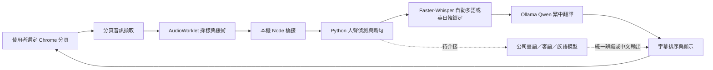
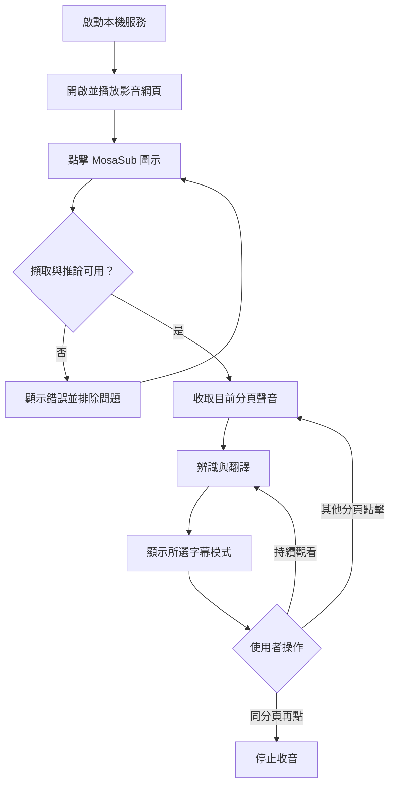

# MosaSub Live 校園組作品提案草稿

更新：2026-09-13。依 2026-09-09 會議與 0.3.6 實作整理。逐字稿未標示說話者且含辨識誤字，因此以需求整理呈現，不視為逐字引用。參賽者與指導老師資料另填。

## 作品摘要

MosaSub Live 協助觀眾理解影音中的陌生語言。使用者在 Chrome 開啟影片或直播，點擊擴充套件選定目前分頁，系統擷取分頁聲音，經人聲斷句、語音辨識與翻譯，在畫面顯示原文及繁體中文字幕。使用者可選單語或雙語，調整字幕外觀與停留時間。原型採 Windows 本機推論，已具備英文、日文、韓文等多語辨識路徑。後續以公司既有臺語、客語及族語模型拓展在地影音理解，實際支援語別與品質依模型介接驗證確認。

## 一、使用者與問題

主要使用者是觀看外語直播、訪談與教學影片，但無法即時理解口語內容的觀眾。另一個情境是理解臺灣本土語言影音。影片缺少字幕、直播尚無人工字幕，以及現有字幕不含觀眾熟悉語言時，使用者需要隨看隨開的輔助工具。

第一階段聚焦桌面 Chrome 網頁影音。每次只翻譯一個分頁；不納入桌面全系統音訊、會議紀錄、字幕匯出與直播製作工具。

## 二、具體情境

使用者觀看英文直播卻聽不懂，先啟動本機服務，播放影片，點擊 MosaSub 圖示。畫面出現繁中與英文字幕；只想閱讀中文時切換「僅繁中」。換看另一個影音分頁時，在新分頁點擊圖示即可切換來源。結束時在收音分頁再點一次停止。

同頁多支影片同時發聲時，第一階段請使用者暫停其他播放器。選定分頁並不代表能隔離該分頁內單一影片，後續若新增播放器隔離，需另驗證跨來源影音與嵌入播放器的限制。

在地情境可用臺語或客語影音展示「聽不懂原語言，但能閱讀中文」的價值。公司已提供模型資源前提；實際串接完成前，不在展示中宣稱已支援。

## 三、特色與目前功能

- 逐步辨識與定稿字幕，降低等待完整長句的空白時間。
- 自動多語辨識，或鎖定英文、日文、韓文；原文／繁中／雙字幕切換。
- 可調字幕大小、透明度、位置與停留時間。
- 人聲斷句、有限重試、播放中斷重設與音訊緩衝上限。
- 前文用語、術語庫與品質標記輔助翻譯；不能保證同音詞皆正確。
- 說話者辨識已移除；實播準確度不足，不列為作品能力。
- 本機語音辨識與翻譯；預設路徑不需將音訊送到外部翻譯服務。

## 四、系統架構

公司模型輸出可能是原語轉寫或直接中文結果，接入前需確認，不能假設所有模型使用相同介面。需確定載入方式、採樣率、支援語別、輸出格式、推論資源及能否增量處理。此工作是接用現有模型，不是重新研發模型。

## 五、操作流程

## 六、開發與交付方式

原型使用 Chrome Manifest V3、JavaScript、Node、Python、Faster-Whisper、Silero VAD 與 Ollama。先以私人 GitHub 儲存庫交付原始碼、安裝方法與驗收紀錄。商店上架列為後續交付途徑，須整理安裝依賴、權限說明與資料處理說明，並完成網站相容性驗證。

目前載入未封裝擴充套件與啟動本機服務的步驟仍偏多。下一步以可重複安裝及清楚的啟動狀態降低使用門檻，再評估安裝程式與商店版本。

## 七、商業與競賽價值

校園作品以跨語影音理解與本土語言可近性為主軸。先验证使用者是否能更快理解影片內容，再評估個人付費或機構導入；尚無已驗證收入或付費意願數據。

中華電信連結仍是待落地項目，可評估影音場景或其運算服務，但沒有已完成串接的證據，提案不得寫成既有合作。公司社會組另案規劃，不在本作品中混入未實作的公司產品功能。

## 八、成果與品質評估

現有 30 分鐘實播紀錄得到 288 次定稿，服務未重啟，但有 2 次處理錯誤及 24,704ms 音訊丟棄。顯存變化受到同時遊戲影響，無法直接歸因於字幕程式洩漏。這份紀錄不能代表翻譯準確率通過。

後續驗收需同時記錄停句至定稿中位數／95 百分位、首段中文時間、丟棄音訊比例與錯誤數。每語言建立經人工確認的音訊與參考文本，評估辨識錯字、數字、否定、專名與翻譯語意。公司模型另以各語言獨立樣本驗證，避免以英文成果推論族語品質。

## 九、近期落地順序

1. 以最新版完成 Twitch 與另一影音網站的啟動、停止、切換來源及單雙字幕驗收。
2. 建立英日韓真人音訊與人工參考文本，分開評估 ASR 與翻譯品質。
3. 進行新版 60 分鐘長播、廣告／換畫質與全螢幕恢復測試。
4. 依公司模型實際介面加入臺語、客語及族語辨識路徑。
5. 補齊匿名參賽資料與展示素材，進行正式提案送件前檢查。

## 十、會議對應

01:39–04:49：明確說明使用者、情境與操作方式。
05:32–06:58：在地語言應用方向。
08:10–09:08：完整提案與公司私人儲存庫。
09:09–10:45：影音來源選擇與瀏覽器範圍。
10:45–12:28：容易取得、容易使用，以及架構圖與流程圖。
